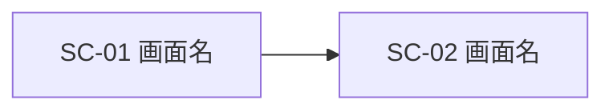

<!--
  このテンプレートは、新しいシステム・アプリを作る案件の親Issueに使います。
  案件全体の目的・業務・画面構成・データ・運用を合意し、
  画面ごとの詳細な仕様（項目・操作・受け入れ条件）は「新規案件の画面」の子Issueに、
  複数の画面にまたがる機能の仕様は「新規機能追加」の子Issueに記載します。
  既存のシステムに機能を1つ追加するだけの場合は、「新規機能追加」で起票してください。
-->

## 0. 管理情報［起票時必須］
<!-- 不明な項目は「未定」と記載してください。 -->
- 親Issue：#
- 優先度：高／中／低／未定
- 希望期限・受入期限：
- 依頼部署・依頼者：
- 案件の責任者（仕様を最終決定する人）：
- 先行Issue（これが終わらないと着手できない）：#
- 後続Issue（これの完了を待っている）：#
<!-- 先行・後続の関係は、GitHubの「Blocked by／Blocking」にも登録してください。 -->

## 1. 案件概要・目的［起票時必須］
<!-- 実装方法ではなく、誰のどの課題を解決するかを記載してください。 -->
- 案件の概要：
- 背景（なぜ今必要か）：
- 現在の課題：
- 達成したい状態・期待する効果：
  <!-- 可能であれば数値で記載してください。例：集計作業を週3時間から30分にする -->
- 効果の確認方法・時期：

## 2. 関係者［起票時必須］
<!-- 該当しない役割は「該当なし」、未定の場合は「未定」と記載してください。 -->

| 役割 | 部署・氏名 | 関わり方 |
|---|---|---|
| 依頼者 |  |  |
| 主な利用者 |  | 人数・利用頻度 |
| 仕様の確認・合意担当者 |  |  |
| 受け入れ確認担当者 |  |  |
| データ・システムの提供元 |  | 連携するDB・システムの管理者 |
| 開発担当者 |  |  |

## 3. 業務の現状と導入後［起票時必須］
<!-- 今の業務の流れと、システム導入後の流れを記載してください。手順の箇条書きで構いません。 -->

### 現状の業務（As-Is）
<!-- 誰が、何を見て、どの作業をしているか。使っているExcel・紙・既存システムも記載してください。 -->
1. 
2. 
3. 

### 導入後の業務（To-Be）
1. 
2. 
3. 

### 置き換える・廃止する既存の資料・仕組み
<!-- ない場合は「なし」と記載してください。並行運用の期間があれば併記してください。 -->
- 

## 4. 仕様・画面資料の管理先［起票時必須］
<!-- 仕様の正本を1つ決めてください。別の仕様書を使う場合、詳細をこのIssueへ二重に記載する必要はありません。 -->
- 仕様の正本：このIssue／別の仕様書
- 仕様書のパス・URL（別管理の場合）：
- 合意した仕様の版・コミット（別管理の場合）：
- 画面資料の保存先：
  <!-- 下記「画面資料の管理ルール」に沿って、合意後の保存先を記載してください。例：docs/screens/123-稼働状況表示/ -->

<!--
  画面資料の管理ルール
  - 検討中：画像はこのIssueに直接貼り付けます。手書きの写真、Excel・PowerPointの図、既存画面のキャプチャで構いません。
  - 合意時：対象リポジトリの docs/screens/<Issue番号>-<案件名>/ に保存してコミットします。
      - ファイル名は「画面ID_画面名」とします。例：SC-01_検索.drawio.svg
      - 推奨：draw.io（diagrams.net）で作成し、.drawio.svg 形式で保存します。
        1つのファイルが画像と編集元を兼ね、GitHub上ではそのまま画像として表示されます。
        VS Codeでは拡張機能「Draw.io Integration」で編集できます。
        変更箇所をGitの差分で追えるよう、draw.io の「ファイル」→「プロパティ」で「圧縮」をオフにしてください。
      - draw.io 以外で作成した場合は、画像（.png）と編集元のファイル（.pptx・.xlsx など）を同じフォルダに保存します。
      - 6章の「イメージの状態」を「確定」にし、保存先とコミットを本Issueに記載します。
  - 合意後の変更：同じファイル名で上書きしてコミットし、13章の仕様変更履歴に記載します。過去の版はGitの履歴で確認します。
  - リポジトリがまだない場合：作成するまではこのIssueを正本とし、作成後に上記の場所へ移します。
  - 実データの画面キャプチャを使う場合は、得意先名・個人名・認証情報などを伏せてください。
-->

## 5. スコープとフェーズ［実装着手前に合意］
<!-- 一度に全部を作らず、最初のリリースで使い始められる範囲を決めてください。 -->

### フェーズ1（最初のリリース）で対応すること
- 

### フェーズ2以降に回すこと
- 

### この案件では対応しないこと
- 

### ユースケース
<!-- 利用者の目的と、一連の操作・結果を記載してください。複数ある場合は追加してください。 -->

#### UC-01：
- 利用者：
- 達成したいこと：
- 基本の流れ：
  1. 
  2. 
  3. 
- 完了後の状態：
- フェーズ：1／2以降

## 6. 画面構成・画面イメージ［実装着手前に合意］
<!-- 見た目の細部ではなく、「何が表示され、何ができるか」を合意するための章です。 -->
<!-- 画像の代わりに、文字で画面の配置を書いても構いません（記入例を参照）。 -->

### 画面一覧

| 画面ID | 画面名 | 目的・主な操作 | 利用者 | 対応するUC | フェーズ | イメージの状態 |
|---|---|---|---|---|---|---|
| SC-01 |  |  |  | UC-01 | 1 | なし／ラフ／確定 |

### 画面遷移
<!-- 画面が2つ以上ある場合に記載してください。Mermaidで書くと、Issue上で図として表示されます。 -->

### SC-01：［画面名］
<!-- ここには合意に必要な概要を記載し、詳細は「新規案件の画面」の子Issueで詰めてください。 -->
- 画面イメージ：
  <!-- 画像を貼り付けてください。合意後は保存先のファイルへのリンクに置き換えます。 -->
- 参考にする既存の画面・システム・帳票：

| No | 項目名 | 種類 | 表示形式・初期値 | データの出どころ | 備考 |
|---|---|---|---|---|---|
| 1 |  | 表示／入力／選択／ボタン |  |  |  |

- 主な操作と結果：
  <!-- 例：「検索」を押すと、条件に一致する行を日付の昇順で表示する。 -->
- データがないとき・エラーのときの表示：
- 権限によって表示・操作が変わる部分：

<!-- 画面ごとに「### SC-02：［画面名］」を追加してください。 -->

## 7. データ・連携・出力［実装着手前に合意］
<!-- 該当しない項目は「該当なし」と記載してください。 -->

### 取得するデータ

| データ | 取得元（DB・システム・ファイル） | 更新頻度・タイミング | 取得元の管理者 | 備考 |
|---|---|---|---|---|
|  |  |  |  |  |

### 保存するデータ
<!-- この案件で新たに保存するデータ。保存期間・削除の要否も記載してください。 -->
- 

### 出力・帳票
<!-- CSV・Excel・印刷・メール通知など。形式・列・ファイル名の決まりがあれば記載してください。 -->
- 

### 用語・集計の定義
<!-- 「稼働率」「不良率」など、計算式や対象範囲の解釈が分かれる用語を定義してください。 -->

| 用語 | 定義・計算式 | 根拠・確認先 |
|---|---|---|
|  |  |  |

## 8. 利用環境・配布・運用［実装着手前に合意］
- 利用者数・同時利用数：
- 利用する場所・端末・OS：
- 種類：Webアプリ／デスクトップアプリ／バッチ／その他
- 配布・更新の方法：
- 利用開始時の準備（アカウント・権限・設定）：
- 問い合わせ窓口・障害時の連絡先：
- 運用・保守の担当（リリース後）：

## 9. 非機能要件・制約
<!-- 必要な項目だけ記載してください。数値目標には測定条件も記載してください。 -->
<!-- 未決定は「要確認」、対象外は「該当なし」と明記してください。 -->
- 性能・処理量：
- セキュリティ・個人情報：
- 対応環境・互換性：
- アクセシビリティ：
- ログ・監視・運用：
- 予算・体制・その他の制約：

## 10. 案件の受け入れ条件［実装着手前に合意］
<!-- 業務の流れとして使えることを確認する条件を、フェーズごとに記載してください。 -->
<!-- 画面・機能ごとの細かい受け入れ条件は、子Issueに記載します。 -->

### AC-01：［確認する業務シナリオ］
- 対応するUC・画面：UC-01、SC-01
- Given（前提）：
- When（操作・出来事）：
- Then（期待する結果）：

## 11. 未決事項・確認事項
<!-- 実装を妨げる未決事項と、後から決められる事項を区別してください。 -->

| ID | 未決事項 | 確認先 | 実装着手を妨げるか | 結論・関連リンク |
|---|---|---|---|---|
| Q-01 |  |  | はい／いいえ |  |

## 12. 仕様レビュー・合意
<!-- 合意後の仕様変更は、13章の仕様変更履歴にも記録してください。 -->
- [ ] 目的・効果と、導入後の業務の流れが明確になっている
- [ ] フェーズ1の範囲が明確になっている
- [ ] 画面一覧・画面遷移・各画面の項目が合意されている
- [ ] 画面資料が合意した保存先に保存されている
- [ ] データの取得元と、用語・集計の定義が明確になっている
- [ ] 実装着手を妨げる未決事項が解消されている
- [ ] 案件の責任者・仕様確認担当者と開発チームが合意している

- 合意日：
- 合意を確認できるコメント・レビュー：
- 合意した画面資料のコミット：

## 13. 仕様変更履歴
<!-- 合意後に仕様・画面を変更した場合、正本と受け入れ条件を更新し、必要な再合意を行ってください。 -->

| 日付 | 変更内容・理由 | 実装・テスト・日程への影響 | 合意したコメント・レビュー |
|---|---|---|---|
|  |  |  |  |

---

## 14. 技術方針・開発計画（開発チーム記入）
- 対象リポジトリ：
- 技術構成（言語・フレームワーク・DB）：
- 設計資料・設計PR：
- 既存システムへの影響：
- リリース方法・切り戻し方針：

### DB変更と配備順序
<!-- DB変更がない場合は「なし」とだけ記載してください。 -->
- DB変更の有無・対象（テーブル・SP・関数など）：
- 配備順序：DB先行／アプリ先行／同時
- 新旧の互換性：
  <!-- 例：既存のテーブル・SPを使っている他のアプリに影響しないか -->
- DBの切り戻し方法：

### 子Issue
<!-- 画面ごとに「新規案件の画面」、複数の画面にまたがる機能は「新規機能追加」、開発チーム内の作業は「開発課題管理」で起票し、このIssueを親Issueに指定してください。 -->
<!-- GitHubのsub-issueにも登録してください。 -->

| Issue | 内容 | 対応する画面・UC | フェーズ | 状態 |
|---|---|---|---|---|
| # |  |  |  | 未着手／対応中／完了 |

## 15. 検証・リリース結果（開発チーム記入）

| 受け入れ条件 | 検証方法 | 結果 | 証跡・関連PR |
|---|---|---|---|
| AC-01 |  | 未実施／合格／不合格 |  |

- リリース日・バージョン：
- 利用開始後の効果の確認結果：

## 16. 完了条件
- [ ] 子Issueがすべて完了している
- [ ] 案件の受け入れ条件の検証が合格している
- [ ] 画面資料・仕様書が、リリースした内容に合わせて更新されている
- [ ] 利用者向けの手順書・周知が完了している
- [ ] 運用・保守の担当と問い合わせ窓口が決まっている
- [ ] 受け入れ確認担当者の確認が完了している

## 関連情報
- 元の依頼・相談の記録：
- 参考資料（既存の帳票・Excel・他システム）：
- 関連PR：
