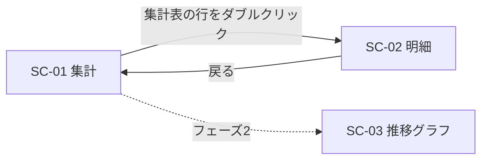

## 0. 管理情報
- 親Issue：なし（このIssueを起点とする）
- 優先度：中
  毎週の集計作業に時間がかかっているが、現行のExcel集計で業務は回っているため。
- 希望期限・受入期限：2027-03-31（フェーズ1の利用開始）
- 依頼部署・依頼者：製造課 課長
- 案件の責任者（仕様を最終決定する人）：製造課 課長
- 先行Issue（これが終わらないと着手できない）：なし
- 後続Issue（これの完了を待っている）：なし

## 1. 案件概要・目的
- 案件の概要：
  生産管理システムの作業日報データから、設備の停止時間を理由別に集計し、
  画面とCSVで確認できるデスクトップアプリを作る。
- 背景（なぜ今必要か）：
  来年度から、停止時間の削減目標を設備ごとに毎週確認することになった。
- 現在の課題：
  - 担当者が毎週、生産管理システムからデータを抽出し、Excelで集計している（約3時間）。
  - 担当者によって停止理由のまとめ方が異なり、週ごとの比較ができない。
- 達成したい状態・期待する効果：
  - 週次の集計作業を3時間から10分以内にする。
  - 全員が同じ定義で集計した停止時間を確認できる。
- 効果の確認方法・時期：
  利用開始から1か月後に、集計作業の時間を担当者に聞き取る。

## 2. 関係者

| 役割 | 部署・氏名 | 関わり方 |
|---|---|---|
| 依頼者 | 製造課 課長 | 目的・優先度の決定 |
| 主な利用者 | 製造課 班長 | 5人。毎週月曜に前週分を確認する |
| 仕様の確認・合意担当者 | 製造課 課長、製造課 班長1名 | 画面・集計定義の確認 |
| 受け入れ確認担当者 | 製造課 班長1名 | フェーズ1の受け入れ確認 |
| データ・システムの提供元 | 情報システム課 | 生産管理システムのDB参照権限の付与 |
| 開発担当者 | 開発チーム | 設計・実装・配布 |

## 3. 業務の現状と導入後

### 現状の業務（As-Is）
1. 担当者が毎週月曜に、生産管理システムの画面から前週の作業日報をCSVで出力する。
2. Excelに貼り付け、停止理由ごとに手作業で分類・集計する。
3. 集計結果を共有フォルダに置き、朝礼で班長が確認する。

### 導入後の業務（To-Be）
1. 班長がアプリを起動し、設備と期間を選んで検索する。
2. 停止理由別の集計表と、日報ごとの明細を画面で確認する。
3. 必要に応じてCSVを出力し、会議資料に使う。

### 置き換える・廃止する既存の資料・仕組み
- 週次集計のExcelファイル。
  利用開始後の2週間は並行運用し、集計結果が一致することを確認してから廃止する。

## 4. 仕様・画面資料の管理先
- 仕様の正本：このIssue
- 仕様書のパス・URL（別管理の場合）：該当なし
- 合意した仕様の版・コミット（別管理の場合）：該当なし
- 画面資料の保存先：
  リポジトリ作成後に docs/screens/1-停止時間集計/ へ移す（現在はこのIssueが正本）。
  合意時に手書きのラフを draw.io で清書し、SC-01_集計.drawio.svg、SC-02_明細.drawio.svg として保存する。

## 5. スコープとフェーズ

### フェーズ1（最初のリリース）で対応すること
- 設備・期間を指定した停止時間の検索。
- 停止理由別の集計表と、日報ごとの明細の表示。
- 集計表・明細のCSV出力。

### フェーズ2以降に回すこと
- 週ごとの推移グラフ。
- 削減目標の登録と、目標との比較表示。

### この案件では対応しないこと
- 作業日報の入力・修正（生産管理システムで行う）。
- 他工場の設備への対応。

### ユースケース

#### UC-01：前週の停止時間を理由別に確認する
- 利用者：製造課 班長
- 達成したいこと：前週に停止時間が長かった理由を確認し、朝礼で共有する。
- 基本の流れ：
  1. アプリを起動し、設備と期間（前週の月曜〜日曜）を選んで検索する。
  2. 停止理由別の集計表で、停止時間の長い理由を確認する。
  3. 気になる理由を選び、対象の日報の明細を確認する。
- 完了後の状態：停止時間の長い理由と、その日時・注番が分かる。
- フェーズ：1

#### UC-02：集計結果を会議資料に使う
- 利用者：製造課 班長
- 達成したいこと：集計結果をExcelの会議資料に貼り付ける。
- 基本の流れ：
  1. UC-01と同じ手順で検索する。
  2. 「CSV出力」を押し、保存先を選ぶ。
  3. 出力したCSVをExcelで開く。
- 完了後の状態：画面と同じ内容のCSVが保存されている。
- フェーズ：1

## 6. 画面構成・画面イメージ

### 画面一覧

| 画面ID | 画面名 | 目的・主な操作 | 利用者 | 対応するUC | フェーズ | イメージの状態 |
|---|---|---|---|---|---|---|
| SC-01 | 集計 | 設備・期間を指定して検索し、理由別の集計を見る | 班長 | UC-01、UC-02 | 1 | ラフ |
| SC-02 | 明細 | 選んだ停止理由の日報を一覧で見る | 班長 | UC-01 | 1 | ラフ |
| SC-03 | 推移グラフ | 週ごとの停止時間の推移を見る | 班長 | ― | 2 | なし |

### 画面遷移



### SC-01：集計
- 画面イメージ：
  手書きのラフ（SC-01_集計.jpg）を起票時に添付。配置は以下のとおり。

```text
設備[1号機 ▼]  期間[2027/04/05]～[2027/04/11]  [検索]  [CSV出力]
-------------------------------------------------------------
停止理由 | 停止時間(分) | 件数 | 割合
段取     | 320          | 12   | 41.0%
故障     | 180          | 3    | 23.1%
…
合計     | 780          | 35   | 100.0%
```

- 参考にする既存の画面・システム・帳票：現行の週次集計Excelの「理由別」シート。

| No | 項目名 | 種類 | 表示形式・初期値 | データの出どころ | 備考 |
|---|---|---|---|---|---|
| 1 | 設備 | 選択 | 初期値は前回選んだ設備 | 設備マスタ | 未選択では検索できない |
| 2 | 期間（開始・終了） | 入力 | yyyy/MM/dd。初期値は前週の月曜〜日曜 | ― | 最大93日 |
| 3 | 検索 | ボタン | ― | ― | 検索中は押せない |
| 4 | CSV出力 | ボタン | ― | ― | 検索前は押せない |
| 5 | 停止理由 | 表示 | ― | 停止理由マスタ | 7章の定義で分類する |
| 6 | 停止時間(分) | 表示 | 整数、3桁区切り | 作業日報の停止時間 | 7章の定義で集計する |
| 7 | 件数 | 表示 | 整数 | 作業日報 | 停止理由ごとの日報の件数 |
| 8 | 割合 | 表示 | 小数第1位まで | No6から計算 | 合計に対する割合 |

- 主な操作と結果：
  - 「検索」を押すと、指定した設備・期間の停止時間を理由別に、停止時間の降順で表示する。
  - 集計表の行をダブルクリックすると、その理由の明細（SC-02）を開く。
  - 「CSV出力」を押すと、表示中の集計表をCSVで保存する。
- データがないとき・エラーのときの表示：
  - 該当する日報がない場合は「指定した期間のデータはありません」と表示する。
  - DBに接続できない場合は「データを取得できませんでした。時間をおいて再度お試しください」と表示する。
- 権限によって表示・操作が変わる部分：なし（利用者全員が同じ操作をできる）。

### SC-02：明細
- 画面イメージ：手書きのラフ（SC-02_明細.jpg）を起票時に添付。
- 参考にする既存の画面・システム・帳票：生産管理システムの作業日報照会画面。

| No | 項目名 | 種類 | 表示形式・初期値 | データの出どころ | 備考 |
|---|---|---|---|---|---|
| 1 | 作業日 | 表示 | yyyy/MM/dd | 作業日報 |  |
| 2 | 注番 | 表示 | ― | 作業日報 |  |
| 3 | 停止時間(分) | 表示 | 整数 | 作業日報の停止時間 |  |
| 4 | 備考 | 表示 | ― | 作業日報 | 長い場合は省略し、マウスを重ねると全文を表示する |
| 5 | CSV出力 | ボタン | ― | ― |  |
| 6 | 戻る | ボタン | ― | ― | SC-01の検索条件と結果を保持して戻る |

- 主な操作と結果：作業日の昇順で表示する。
- データがないとき・エラーのときの表示：SC-01と同じ。
- 権限によって表示・操作が変わる部分：なし。

## 7. データ・連携・出力

### 取得するデータ

| データ | 取得元（DB・システム・ファイル） | 更新頻度・タイミング | 取得元の管理者 | 備考 |
|---|---|---|---|---|
| 作業日報・停止時間 | 生産管理システムのDB | 日報の登録時（随時） | 情報システム課 | 参照のみ |
| 設備マスタ・停止理由マスタ | 生産管理システムのDB | 不定期 | 情報システム課 | 参照のみ |

### 保存するデータ
- 前回選んだ設備（利用者のPCに保存）。

### 出力・帳票
- CSV（UTF-8、BOMあり）。列は画面の表示と同じ順にする。
- ファイル名：停止時間集計_<設備>_<開始日>-<終了日>.csv

### 用語・集計の定義

| 用語 | 定義・計算式 | 根拠・確認先 |
|---|---|---|
| 停止時間 | 作業日報に登録された停止時間の合計（分）。取消された日報は除く | 製造課 課長（Q-01で確認中） |
| 対象の日報 | 作業日が期間内にある日報。修正された日報は最新の版だけを使う | 情報システム課 |

## 8. 利用環境・配布・運用
- 利用者数・同時利用数：5人、同時利用は最大3人。
- 利用する場所・端末・OS：製造課の事務所PC（Windows 11）。
- 種類：デスクトップアプリ
- 配布・更新の方法：共有フォルダに配置し、起動時に新しい版があれば更新する。
- 利用開始時の準備（アカウント・権限・設定）：DB参照用のアカウントを情報システム課に申請する。
- 問い合わせ窓口・障害時の連絡先：開発チーム。
- 運用・保守の担当（リリース後）：開発チーム。

## 9. 非機能要件・制約
- 性能・処理量：
  1設備・31日分の検索で、検索ボタンを押してから10秒以内に表示する（事務所PC、通常の業務時間帯）。
- セキュリティ・個人情報：
  DBの接続情報はアプリの設定ファイルに保存し、Issue・ログに記載しない。
- 対応環境・互換性：Windows 11。
- アクセシビリティ：該当なし。
- ログ・監視・運用：エラー発生時は、日時とエラー内容をログファイルに記録する。
- 予算・体制・その他の制約：開発担当者1名。生産管理システムのDBには変更を加えない。

## 10. 案件の受け入れ条件

### AC-01：前週の停止時間を、現行のExcelと同じ結果で確認できる
- 対応するUC・画面：UC-01、SC-01、SC-02
- Given（前提）：
  前週分を現行のExcelで集計した結果がある。
- When（操作・出来事）：
  アプリで同じ設備・期間を検索する。
- Then（期待する結果）：
  停止理由ごとの停止時間・件数が、Excelの集計結果と一致する。
  差がある場合は、7章の定義による差であることを説明できる。

### AC-02：集計結果を会議資料に使える
- 対応するUC・画面：UC-02、SC-01
- Given（前提）：
  SC-01で検索結果を表示している。
- When（操作・出来事）：
  CSVを出力し、Excelで開く。
- Then（期待する結果）：
  画面と同じ内容が文字化けせずに表示される。

## 11. 未決事項・確認事項

| ID | 未決事項 | 確認先 | 実装着手を妨げるか | 結論・関連リンク |
|---|---|---|---|---|
| Q-01 | 停止時間に「休憩」を含めるか | 製造課 課長 | はい | 未確認。現行のExcelでは含めていない |
| Q-02 | 推移グラフを週単位にするか月単位にするか | 製造課 班長 | いいえ | フェーズ2の着手前に決める |

## 12. 仕様レビュー・合意
- [ ] 目的・効果と、導入後の業務の流れが明確になっている
- [ ] フェーズ1の範囲が明確になっている
- [ ] 画面一覧・画面遷移・各画面の項目が合意されている
- [ ] 画面資料が合意した保存先に保存されている
- [ ] データの取得元と、用語・集計の定義が明確になっている
- [ ] 実装着手を妨げる未決事項が解消されている
- [ ] 案件の責任者・仕様確認担当者と開発チームが合意している

- 合意日：未合意
- 合意を確認できるコメント・レビュー：未登録
- 合意した画面資料のコミット：未登録

## 13. 仕様変更履歴
合意後の変更なし（現在は仕様レビュー前）。

| 日付 | 変更内容・理由 | 実装・テスト・日程への影響 | 合意したコメント・レビュー |
|---|---|---|---|
| ― | ― | ― | ― |

---

## 14. 技術方針・開発計画（開発チーム記入）
<!-- 以下は案。仕様合意後に確定する。 -->
- 対象リポジトリ：新規作成（作成後に追記）。
- 技術構成（言語・フレームワーク・DB）：C#、WPF、生産管理システムのDB（参照のみ）。
- 設計資料・設計PR：未作成。
- 既存システムへの影響：生産管理システムのDBを参照するだけで、変更しない。
- リリース方法・切り戻し方針：
  共有フォルダに配置する。問題が発生した場合は、並行運用中のExcel集計に戻す。

### DB変更と配備順序
- なし

### 子Issue

| Issue | 内容 | 対応する画面・UC | フェーズ | 状態 |
|---|---|---|---|---|
| #（起票後に追記） | ［機能追加］停止時間の理由別集計と明細表示 | SC-01、SC-02、UC-01 | 1 | 未着手 |
| #（起票後に追記） | ［機能追加］集計表・明細のCSV出力 | SC-01、SC-02、UC-02 | 1 | 未着手 |
| #（起票後に追記） | ［開発課題］リポジトリ作成と配布の仕組みの準備 | ― | 1 | 未着手 |

## 15. 検証・リリース結果（開発チーム記入）

| 受け入れ条件 | 検証方法 | 結果 | 証跡・関連PR |
|---|---|---|---|
| AC-01 | 並行運用の2週間、Excelの集計結果と比較する | 未実施 | 未登録 |
| AC-02 | 出力したCSVを事務所PCのExcelで開く | 未実施 | 未登録 |

- リリース日・バージョン：未リリース
- 利用開始後の効果の確認結果：未確認

## 16. 完了条件
- [ ] 子Issueがすべて完了している
- [ ] 案件の受け入れ条件の検証が合格している
- [ ] 画面資料・仕様書が、リリースした内容に合わせて更新されている
- [ ] 利用者向けの手順書・周知が完了している
- [ ] 運用・保守の担当と問い合わせ窓口が決まっている
- [ ] 受け入れ確認担当者の確認が完了している

## 関連情報
- 元の依頼・相談の記録：製造課との打ち合わせメモ（起票時に添付）
- 参考資料（既存の帳票・Excel・他システム）：現行の週次集計Excel（架空データに置き換えて添付）
- 関連PR：作成後に追記
